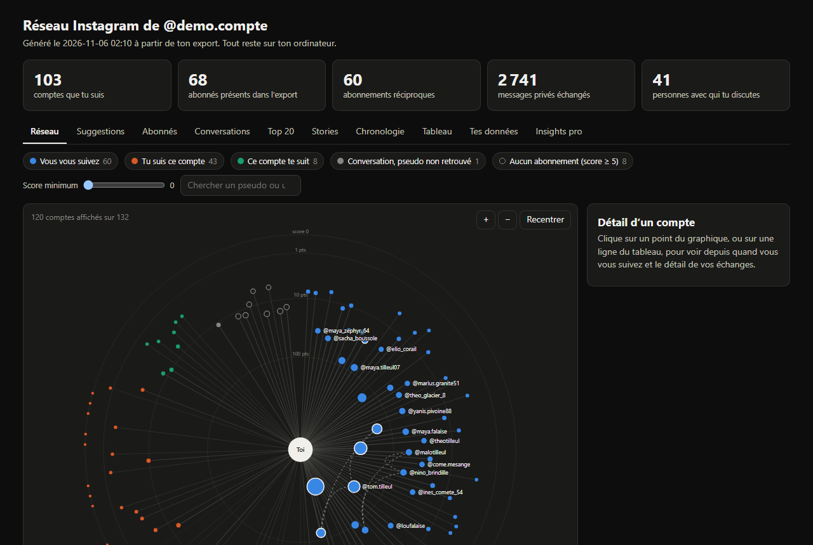

# Réseau Insta

Un script Python qui lit **ton propre export Instagram** et génère une page HTML pour explorer ton réseau : qui te suit, depuis quand, avec qui tu échanges vraiment, et ce qu'Instagram garde sur toi.

Tout se passe sur ton ordinateur. Le script ne se connecte jamais à Instagram, ne demande aucun mot de passe et n'envoie rien sur Internet.



## Ce que montre la page

| Onglet | Contenu |
|---|---|
| **Réseau** | Toi au centre, chaque compte placé selon son score de proximité. Un curseur remonte le temps mois par mois. |
| **Suggestions** | À qui écrire, qui suivre (avec le taux de follow-back mesuré sur ton historique), quand publier. |
| **Abonnés** | Comptes qui ne te suivent pas en retour, abonnés perdus ou gagnés depuis l'export précédent, tri de tes abonnements. |
| **Conversations** | Qui lance la discussion, temps de réponse, conversations qui montent ou s'éteignent. |
| **Top 20** | Les comptes avec lesquels tu échanges le plus, par type d'interaction. |
| **Stories** | Spectateurs et revisionnages de tes stories, à saisir toi-même (Instagram ne les exporte pas). |
| **Chronologie** | Abonnements et abonnés, mois par mois. |
| **Tableau** | Tous les chiffres, triables. |
| **Tes données** | Annonceurs qui utilisent tes données, catégories de ciblage, lieux, contacts synchronisés. |
| **Insights pro** | Les statistiques d'un compte professionnel, si ton export en contient. |

## Ce que l'outil ne fait pas

- Il ne lit que **ton** export. Il ne sait rien des liens entre les autres personnes (qui suit qui, qui like qui).
- Il n'aspire aucun profil et ne pilote pas ton compte : pas de suivi ni de désabonnement automatique. Instagram sanctionne ces pratiques, et elles exposent des gens qui n'ont rien demandé.
- Il ne lit pas le contenu de tes messages, seulement leur nombre et leur date.
- Il ne devine rien sur les gens (genre, âge, intentions). Les étiquettes viennent de toi.

## Essayer sans tes données

Le dépôt contient un générateur d'export fictif : tous les comptes, marques et lieux sont inventés.

```bash
python demo/genere_export_fictif.py
python analyse_instagram.py demo/export_fictif --sortie demo/sortie
```

Ouvre ensuite `demo/sortie/reseau_instagram.html` dans ton navigateur. Une version déjà générée de cette page est incluse dans le dépôt.

## Utilisation avec ton export

Il faut Python 3 (testé avec Python 3.11). Aucune bibliothèque à installer.

### 1. Demander ton export

Dans Instagram : Paramètres → Espace Comptes → Vos informations et autorisations → Exporter vos informations → Créer une exportation → Exporter sur l'appareil.

Deux réglages comptent :

- **Format : JSON** (le format HTML proposé par défaut ne convient pas).
- **Période : Depuis le début.** Avec une période plus courte, les abonnés anciens manquent et beaucoup de chiffres sont faussés.

Instagram envoie un e-mail quand le fichier est prêt.

### 2. Lancer le script

```bash
python analyse_instagram.py chemin/vers/ton-export.zip
```

Le chemin peut être le fichier `.zip` téléchargé ou le dossier dézippé. Sous Windows, remplace `python` par `py` si besoin.

### 3. Ouvrir la page

Le script écrit `mes_donnees/reseau_instagram.html`. Ouvre-la dans ton navigateur.

## Tes fichiers personnels

Tout ce qui te concerne est écrit dans le dossier `mes_donnees/`, que `.gitignore` exclut du dépôt. **Ne le publie jamais** : il contient les pseudos de tes contacts.

| Fichier | Rôle |
|---|---|
| `reseau_instagram.html` | La page générée. |
| `alias.csv` | Conversations dont le pseudo n'a pas été retrouvé. Écris le pseudo en face du nom, puis relance. |
| `etiquettes.csv` | Une ligne par compte. Colonnes libres `etiquette` (pote, famille…) et `genre` (h, f, a). |
| `stories_plus.csv` | Une ligne par story : date, titre, revisionnages, spectateurs. Utile avec Instagram Plus. |
| `historique.json` | La liste de tes abonnés à chaque export, pour repérer les désabonnements au suivant. |

Ces fichiers s'ouvrent dans un tableur. Le séparateur est le point-virgule.

## Options

| Option | Effet |
|---|---|
| `--ancien EXPORT` | Compare tout de suite avec un export plus ancien. |
| `--sortie DOSSIER` | Écrit la page et les fichiers personnels ailleurs que dans `mes_donnees/`. |

## Score de proximité

Le score additionne tes interactions avec un compte : 1 point par message envoyé ou reçu, 1 par like de post, 2 par like de story, 3 par réaction ou commentaire, 0,25 par story que tu as vue, 1 par story à toi vue par ce compte et 2 par revisionnage. Les poids se règlent en haut de `analyse_instagram.py`.

Seuls les messages et les vues de tes stories montrent ce que l'autre personne fait vers toi. Instagram n'exporte ni les likes ni les vues que tu reçois : le reste du score mesure donc ton activité envers le compte.

## Limites connues

- Testé sur des exports en français de novembre 2026. Instagram change régulièrement le format et traduit certains intitulés selon la langue du compte : un export dans une autre langue ou d'une autre époque peut être lu partiellement.
- La page est en français uniquement.
- Les statistiques « Insights pro » n'existent que dans l'export d'un compte professionnel.
- Le taux de follow-back et les suggestions reposent sur ton seul historique : ce sont des indications, pas des prédictions.

## Tests

```bash
python -m unittest discover tests
```

Les tests tournent sur l'export fictif et ne lisent aucune donnée personnelle.

## Licence et mention

Publié sous licence MIT, voir [LICENSE](LICENSE).

Ce projet n'est ni affilié à Instagram ou à Meta, ni approuvé par eux. Instagram est une marque de Meta Platforms, Inc.
